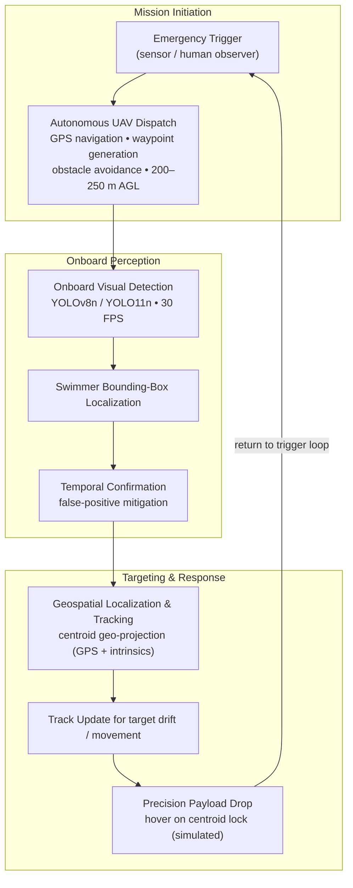
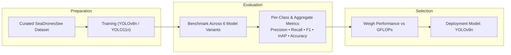

# Autonomous Drone MSAR

  
  
<strong>Real-Time Maritime Search-and-Rescue using Onboard Edge AI and Precision Payload Deployment</strong>

Real-time maritime Search and Rescue (SAR) is among the most time-sensitive operations in emergency response: the interval between the distress notification and victim recovery directly determines survival outcomes. The underlying engineering challenge is that every human step in a conventional response, from the initial sighting to the decision to commit a rescue asset, injects latency into a loop where the target is moving, the environment is hostile, and the recovery window is finite.

This repository designs a closed-loop, autonomous UAV system to compress that loop. Given an emergency alert, the aircraft navigates to a GPS-tagged distress location, runs onboard object detection to locate the victim (a swimmer), and initiates a precision payload drop of a life buoy, all executed on edge-compatible hardware carried by the aircraft itself.

The decision to move compute onboard is fundamental, not incidental. In open-water missions the datalink between a drone and its ground station cannot be assumed reliable, and routing video to a remote operator before any detection decision imposes both latency and operator fatigue at exactly the moments where reaction time matters most. By hosting the perception pipeline directly on the aircraft, the system preserves autonomous decision-making across the entire mission, tolerates degraded or interrupted connectivity, and minimizes the delay between target acquisition and payload actuation.

The enabling innovation is the deployment of highly efficient object detectors (YOLOv8n and YOLO11n), optimized for inference on constrained platforms such as drones. Both were trained and evaluated on a curated and augmented version of the SeaDronesSee dataset, and the detection pipeline is supported by GPS, IMU-based navigation, and temporal tracking for spatial confirmation, which together form a closed-loop UAV SAR system.

## Project Evolution

Autonomous Drone MSAR is the **original implementation** of this concept. It is the first-generation proof that real-time on-drone swimmer detection, backed by onboard edge AI and GPS-guided payload logic, is feasible, and it did so by integrating vision, navigation, tracking, and a precision payload framework into one closed-loop system.

The architecture has since matured. The system has evolved into **[SentinelBlue](https://github.com/InvictusRex/SentinelBlue)**, a second-generation implementation that builds on this foundation with greater modularity, disciplined dataset engineering, a reproducible benchmarking methodology, deployment-oriented tooling, and a longer-term maintenance posture. Where this repository validates the concept end-to-end and selects candidate architectures on edge-compatible hardware, SentinelBlue formalizes those results into a repeatable evaluation framework and a deployment-driven pipeline, while also extending the evaluated architecture set to include YOLO26.

This repository documents the first-generation architecture and its engineering decisions, and it remains the original implementation of the concept. SentinelBlue evolved directly from it and continues as the active development line, building on the validated foundation established here.

## System Overview

Each stage carries a distinct responsibility within the closed loop. **Mission initiation** begins with an emergency trigger originating from sensors or human observers, which automatically launches the UAV. During **autonomous dispatch** the aircraft navigates in real time using GPS, generates dynamic waypoints, and performs obstacle avoidance while holding an altitude band of 200–250 m AGL, a height chosen to keep swimmers in frame while maximizing the ground area searched per flight.

The onboard perception layer then performs frame-wise detection at 30 FPS using the YOLOv8n/YOLO11n variants, yielding real-time bounding-box localization of swimmers. Because single-frame detections are susceptible to wave clutter and transient artifacts, a temporal step confirms targets across successive frames, trading a small increase in latency for a substantial reduction in false positives, a favorable exchange in SAR where a confident, correct detection is worth far more than a rapid, spurious one. Confirmed targets pass to the geospatial localization and tracking stage. Here bounding-box centroids are geo-projected using GPS and camera intrinsics, and the confirmed track is updated to account for target drift and movement. Only after a stable centroid lock is established does the platform hover and prepare the precision payload drop, applying a logic framework for trajectory estimation and actuation.

## Model Selection: Evaluation and Training

Model selection was treated as a constrained engineering tradeoff rather than an accuracy contest. Because the deployment target is a drone, computational cost is a first-class requirement: a detector that performs well offline but cannot sustain interactive rates on edge hardware is operationally irrelevant. Evaluation therefore weighs detection quality against the computational footprint required to achieve it, and every candidate is judged in that context.

### Dataset

The engineering starts with the evaluation foundation. A curated and augmented version of the **SeaDronesSee v10** dataset, enhanced through Roboflow, was prepared so that all candidates train and validate against an identical, maritime-specific distribution representative of the flight regime the model will operate in.

| Property     | Value                                                         |
| :----------- | :------------------------------------------------------------ |
| Source       | Roboflow-enhanced SeaDronesSee v10                            |
| Data Size    | 10,474 images (7,322 train · 2,077 val · 1,075 test)          |
| Classes      | `swimmer`, `boat`, `buoy`, `jetski`, `life_saving_appliances` |
| Augmentation | Cutout + auto-orientation                                     |
| Annotations  | Reformatted with class merging and distribution balancing     |

### Deployment Candidates

Two compact architectures were evaluated as the primary candidates, chosen for their computational economy relative to the constrained onboard target.

| Variant | Architecture                | GFLOPs | Deployment Suitability   |
| :------ | :-------------------------- | :----: | :----------------------- |
| YOLOv8n | CSPDarknet53 (C2f, PAN-FPN) |  8.1   | Edge devices (preferred) |
| YOLO11n | Optimized PANet + backbone  |  6.3   | Ultra low-power devices  |

Training ran for 100 epochs with an AdamW optimizer (momentum 0.9), a learning rate of 0.000714, and an IoU threshold of 0.7. An augmented P2 layer was added specifically to improve small-object detection, a decisive factor at search altitude, where a swimmer may span only a small portion of the frame.

### Training → Evaluation → Model Selection Workflow

This workflow is what separates the engineering outcome from a mere accuracy report: evaluation is not an end point but a decision input that determines which architecture is physically appropriate for an onboard drone, weighing achievable metrics against the on-platform compute and power budget.

## Benchmark Results and Rationale

The controlled benchmark evaluated six model configurations under identical training conditions. Aggregate metrics are only a partial picture in SAR, as they conceal how detection behaves for the small, frequently occluded targets that actually matter. The full comparison is presented below.

| Model   | GFLOPs | Precision | Recall | mAP@50 | mAP@50-95 | F1 Score | Accuracy |
| :------ | :----: | :-------: | :----: | :----: | :-------: | :------: | :------: |
| YOLOv8n |  8.1   |   0.784   | 0.712  | 0.719  |   0.367   |  0.746   |  0.553   |
| YOLOv8s |  28.4  |   0.782   | 0.693  | 0.727  |   0.458   |  0.734   |  0.489   |
| YOLOv8m |  78.7  |   0.841   | 0.737  | 0.759  |   0.468   |  0.836   |  0.613   |
| YOLO11n |  6.3   |   0.770   | 0.714  | 0.718  |   0.364   |  0.742   |  0.558   |
| YOLO11s |  21.3  |   0.852   | 0.699  | 0.761  |   0.466   |  0.768   |  0.588   |
| YOLO11m |  67.7  |   0.867   | 0.735  | 0.769  |   0.466   |  0.787   |  0.590   |

The `m`-family variants produce the strongest raw metrics, yet their GFLOPs footprint is incompatible with drone-based edge execution. The practical decision space sits within the compact `n` variants. **YOLO11n** is the most efficient model at 6.3 GFLOPs, but it lags slightly in F1 and mAP against **YOLOv8n**. Because recall of the swimmer is the operational priority and the two models are otherwise comparable, YOLOv8n is selected as the final deployment model, the strongest balance between detection quality and minimal onboard computational overhead.

## Per-Class Analysis

Decomposing aggregate metrics by class is what turns a scoreboard into an engineering conclusion, exposing where the system is operationally strong and where it is fundamentally constrained.

| Class                 | Precision (v8n) | Recall (v8n) | mAP@50 (v8n) | Precision (v11n) | Recall (v11n) | mAP@50 (v11n) |
| :-------------------- | :-------------: | :----------: | :----------: | :--------------: | :-----------: | :-----------: |
| Swimmer               |      0.727      |    0.698     |    0.696     |      0.712       |     0.707     |     0.697     |
| Boat                  |      0.911      |    0.939     |    0.944     |      0.906       |     0.930     |     0.953     |
| Buoy                  |      0.871      |    0.817     |    0.806     |      0.862       |     0.794     |     0.790     |
| Jetski                |      0.857      |    0.902     |    0.925     |      0.816       |     0.856     |     0.908     |
| Life Saving Appliance |      1.000      |    0.000     |    0.115     |      1.000       |     0.000     |     0.105     |

The class breakdown tells a focused SAR story. **Swimmer** is the critical requirement and, on F1, YOLOv8n has a marginal edge over YOLO11n. Boats and jetskis are detected with high confidence thanks to their large, distinctive silhouettes. The weak point is arguably the most operationally interesting: **life-saving appliances** collapse because of small object size, occlusion, and a sparse presence in the training distribution, a pattern consistent with how rare such equipment is in any real maritime scene.

> [!NOTE]
> Representative inference outputs (bounding boxes over video frames) from synthetic test data and real maritime scenes, including open sea and coastal crowds, are included to demonstrate behavior beyond the aggregate statistics.

## Deployment Guidance

Architecture selection is anchored to the deployment board. **YOLOv8n** is preferred for constrained platforms such as the Raspberry Pi, Jetson Nano, or Jetson Xavier NX. When additional onboard compute is available, **YOLO11s** becomes a candidate for its higher mAP despite its larger 21.3 GFLOPs footprint. The operational constraint is therefore a per-platform trade between achievable metrics and the drone latency budget.

## Outcomes and Constraints of the Primary System

> [!NOTE]
> These outcomes describe what was actually validated in this study.

The work demonstrated the feasibility of detecting **real-time, on-drone** swimmers with minimal latency, confirming that constrained edge inference is sufficient for effective SAR. It validated YOLOv8n's superior F1, mAP, and inference accuracy across every alternative benchmarked. Together these established a conceptual but executable drone response pipeline combining onboard edge AI, GPS-guided payload logic, and tracked detection in one closed loop.

The current implementation is a **conceptual framework** rather than a fully hardened physical rescue system. Key constraints are acknowledged honestly: a physical payload release mechanism has not yet been integrated; detection degrades under extreme conditions such as restricted visibility or significant occlusion; and generalization is bounded by the distribution of the training data, including swimmer pose and lighting variation.

## Real-World Validation

Although developed as an open-source research project, the perception pipeline has also been exercised in practical UAV development environments. The experience gained through real-world deployment influenced several architectural decisions, from achievable inference throughput and thermal margins to how detection confidence behaves under changing lighting and sea state. The system proved capable of running the full onboard loop reliably under operational conditions rather than only in a controlled evaluation setting.

Those lessons carried directly into the design of SentinelBlue. Observed tendencies in data distribution, latency behavior, and edge resource usage during practical deployment are reflected in the deterministic evaluation and deployment methodology that the next-generation system adopts.

## Evolution into SentinelBlue

The constraint list above defines where the next phase of the project points directly. The highest-value step is **real-world field testing with live drones and mechanical payload systems**, bridging the gap from simulated drop to demonstrated actuation. On the perception side, dataset enhancement through synthetic overlays, night vision, and thermal imagery can broaden coverage of rare and low-contrast scenarios. On the platform side, **YOLO11n can be further optimized via pruning and quantization** to widen the envelope of lower-powered carriers, and systematic energy profiling on Jetson/Raspberry Pi class hardware is needed to guarantee sustained UAV operation.

Each of these threads (reproducible evaluation, deployment realism, dataset rigor, and energy-footprint awareness) became the design charter of **SentinelBlue**, the next generation of this system. SentinelBlue carries the learning forward with improved modularity, deterministic dataset engineering, and deployment tooling, while this repository remains the established foundation on which the future is being built.
